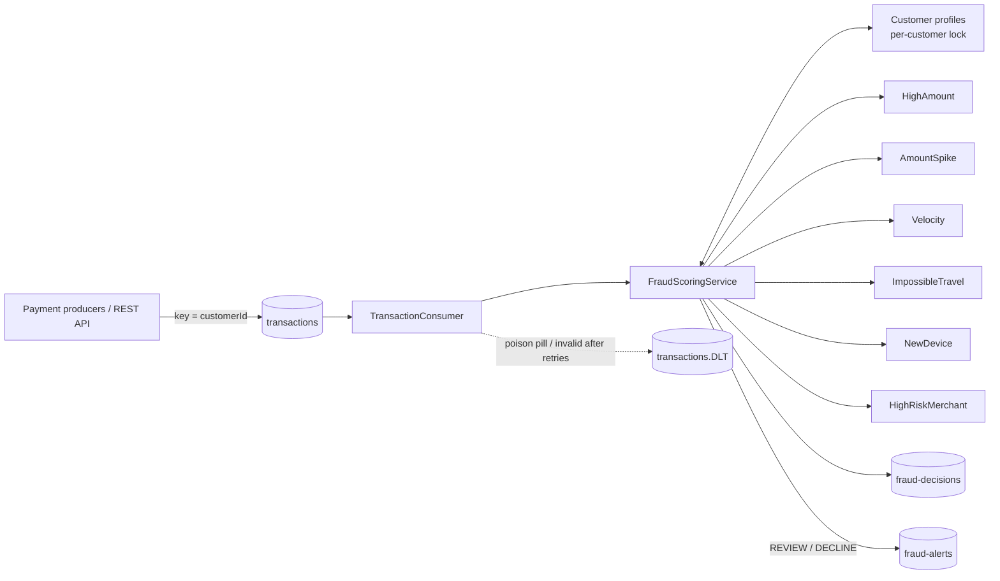

# Real-Time Fraud Detection — Spring Boot + Apache Kafka

An event-driven service that scores card transactions in real time. Transactions stream in on Kafka. Each one is evaluated against the customer's behavioural profile by a pluggable rule engine. The service emits an **APPROVE / REVIEW / DECLINE** decision with an explainable risk score.



## Tech stack
Java 21 · Spring Boot 3.3 · Spring Kafka · Apache Kafka (KRaft) · Micrometer/Prometheus · JUnit 5 + Embedded Kafka · Docker Compose · GitHub Actions

## Fraud rules

| Rule | Fires when | Points |
|---|---|---|
| `IMPOSSIBLE_TRAVEL` | Distance from last transaction ÷ elapsed time > 900 km/h (haversine) | 50 |
| `VELOCITY` | More than 5 attempts within 60 s (event time) | 40 |
| `AMOUNT_SPIKE` | Amount ≥ 5× the customer's running average (min. 5 txns history) | 35 |
| `HIGH_AMOUNT` | Amount ≥ €5,000 | 30 |
| `NEW_DEVICE` | Established customer, unseen device, amount ≥ €1,000 | 25 |
| `HIGH_RISK_MERCHANT` | Gambling, crypto, money transfer, gift cards | 15 |

Points are summed and capped at 100. A score of **≥ 40 is REVIEW** and **≥ 70 is DECLINE**. Every threshold is in `application.yml`. Every decision lists the rules that fired and why, so an analyst can see the reasoning behind it.

## Design decisions

- **Partitioning by `customerId`.** Kafka sends all of a customer's events to one partition, so they're processed in order by one consumer thread. Stateful rules like velocity and travel depend on that ordering.
- **Atomic read → score → update.** Scoring and the profile update happen under a per-customer lock. Different customers score fully in parallel.
- **Idempotent consumer.** Kafka delivers at least once. A bounded LRU of processed transaction IDs means a redelivered event returns the original decision and doesn't double-count toward velocity or averages.
- **Declines don't train the baseline.** A declined transaction counts toward velocity but doesn't add the device to "known devices" or move the reference location. Otherwise one fraudulent charge would make the next one look normal.
- **Bounded memory per customer.** The service keeps a running mean (Welford's method) instead of the full history, plus capped recent-attempt and device windows.
- **Durable publishing.** The producer uses `acks=all` with idempotence enabled. Decisions are published *before* the offset commits (`ack-mode: record`), so a crash causes a re-send, never a lost decision.
- **Dead-letter topic.** Malformed JSON and invalid payloads go to `transactions.DLT` with exception headers, so they don't block the partition. Transient errors get 2 retries first. Validation errors skip retries, since retrying can't fix them.
- **Event time, not wall-clock time.** Replaying a topic reproduces the same decisions.
- **Pluggable rules.** A new rule is one `@Component` implementing `FraudRule`. Rules are pure functions of `(transaction, snapshot)`, so they're easy to unit-test.

## Running it

**Everything in Docker** (Kafka, Kafka UI and the service, with the traffic simulator on):
```bash
docker compose up --build
```
- API: http://localhost:8080 — Kafka UI: http://localhost:8081
- Watch the `fraud-alerts` topic fill up in Kafka UI, or `GET /api/decisions?limit=20`

**Locally** (Kafka in Docker, app from your IDE):
```bash
docker compose up kafka -d
mvn spring-boot:run -Dspring-boot.run.arguments=--fraud.simulator.enabled=true
```

**Tests** (unit tests plus an end-to-end test on an in-process Kafka broker; no Docker needed):
```bash
mvn verify
```

## API

| Method | Path | Purpose |
|---|---|---|
| `POST` | `/api/transactions` | Publish to Kafka; returns **202** once the broker acknowledges |
| `POST` | `/api/transactions/score` | Score synchronously (inline authorisation path) |
| `GET` | `/api/decisions/{id}` | Look up a decision |
| `GET` | `/api/decisions?limit=20` | Most recent decisions |
| `GET` | `/api/stats` | Customers tracked, decisions cached |
| `GET` | `/actuator/prometheus` | `fraud_decisions_total{decision}`, `fraud_rules_triggered_total{rule}`, `fraud_scoring_latency` p50/p95/p99, `fraud_duplicates_total` |

See `requests.http` for ready-made examples. A Dublin purchase followed 10 minutes later by a New York crypto payment on a new device is declined at 100/100.

## Known limitations and next steps
- **State is in-memory**, so it's lost on restart and not shared between instances. The next step is a Kafka Streams state store (changelog-backed, partition-aligned) or Redis.
- **Rules are hand-tuned.** The scoring service could take an ML model score (e.g. a gradient-boosted model served over gRPC) as one more weighted signal.
- **The decision cache is per-instance.** A durable idempotency store would be needed for exactly-once semantics across rebalances.
